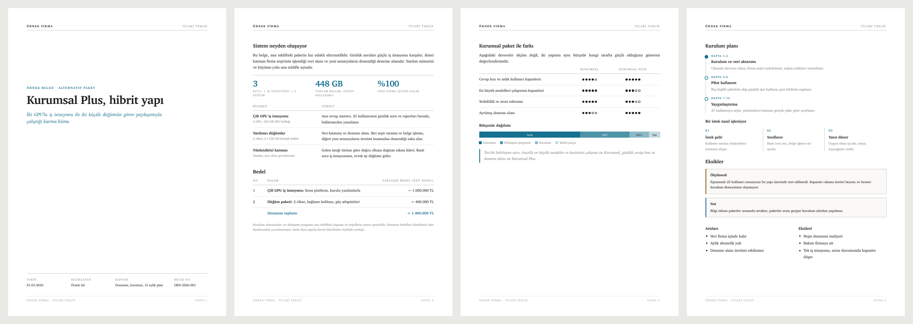

# pdf-rapor

Claude Code skill'i. Kurumsal tasarımlı, infografikli PDF rapor üretir.
HTML yazılır, Chrome ile A4 PDF'e basılır. Ek bağımlılık yok: pandoc,
wkhtmltopdf, LaTeX gerekmez.



## Ne veriyor

- Sabit A4 sayfa düzeni, kapak, üst bar, alt bilgi, otomatik sayfa numarası
- Charter serif tipografi, tek vurgu rengi, sıcak gri çizgiler
- Hazır infografikler: KPI şeridi, yatay bar, yığılmış pay şeridi, SVG donut,
  zaman çizelgesi, süreç akışı, derece daireleri, durum rozetleri
- Rapor dili için kural seti: sıfat yerine rakam, ölçülmeyen şeye "ölçülmedi",
  yapılmayan işe "Eksikler" bölümü

## Kurulum

Bu klasörü skill dizinine kopyala: kullanıcı geneli için `~/.claude/skills/pdf-rapor`, tek proje için
`<proje>/.claude/skills/pdf-rapor`. Depo eklenti olarak kurulduysa ayrıca kopyalamak gerekmez.
Claude Code sonraki oturumda skill'i kendiliğinden görür.

Gereken: macOS + Google Chrome. Sayfa görsellerini doğrulamak için `uv`
(yoksa `sips` ile yalnız ilk sayfa kontrol edilir).

## Kullanım

Claude Code içinde:

```
pdf rapor oluştur
bunu pdf'e dök
teklif hazırla
```

Claude marka adı, belge türü ve hazırlayan bilgisini sorar, sonra raporu kurar,
basar ve her sayfayı görsel olarak kontrol eder.

## Dosyalar

| Dosya | İçerik |
|---|---|
| `SKILL.md` | Akış, dil ve tasarım kuralları, basma ve doğrulama komutları |
| `sablon.html` | Tüm stiller, kapak ve içerik sayfası iskeleti |
| `parcalar.html` | Bileşen galerisi, kopyala yapıştır |
| `ornek/` | Örnek çıktı ve önizleme |

## Renk değiştirme

`sablon.html` içindeki `--vurgu` değişkeni tek vurgu rengidir. Kurumsal renge
çevirmek için yalnız onu değiştir; gri tonlar ve çizgi renkleri sabit kalsın.

```css
--vurgu: #16708f;   /* varsayılan teal */
```

## Notlar

- Her sayfa ayrı bir `<section class="s">`. `position:fixed` ile üst/alt bar
  denendi, Chrome basımında üst bar sayfa altına düşüyor ve sayfa numarası
  çıkmıyor; sabit sayfa yapısı bu yüzden tercih edildi.
- Sayfa içeriği 174 × 258 mm alanı aşarsa PDF sayfa sayısı `<section>` sayısını
  geçer, doğrulama adımı bunu yakalar.
- Metinler Türkçe. Başka dil için `SKILL.md` içindeki dil bölümü değiştirilmeli.
